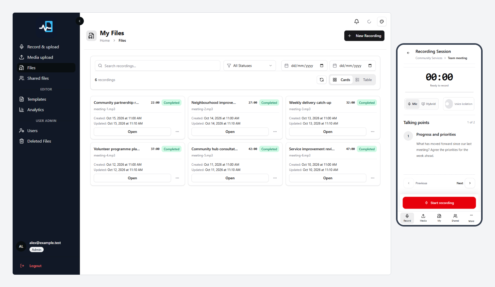
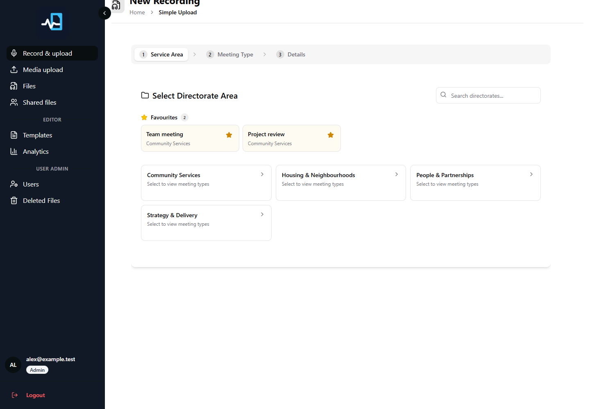
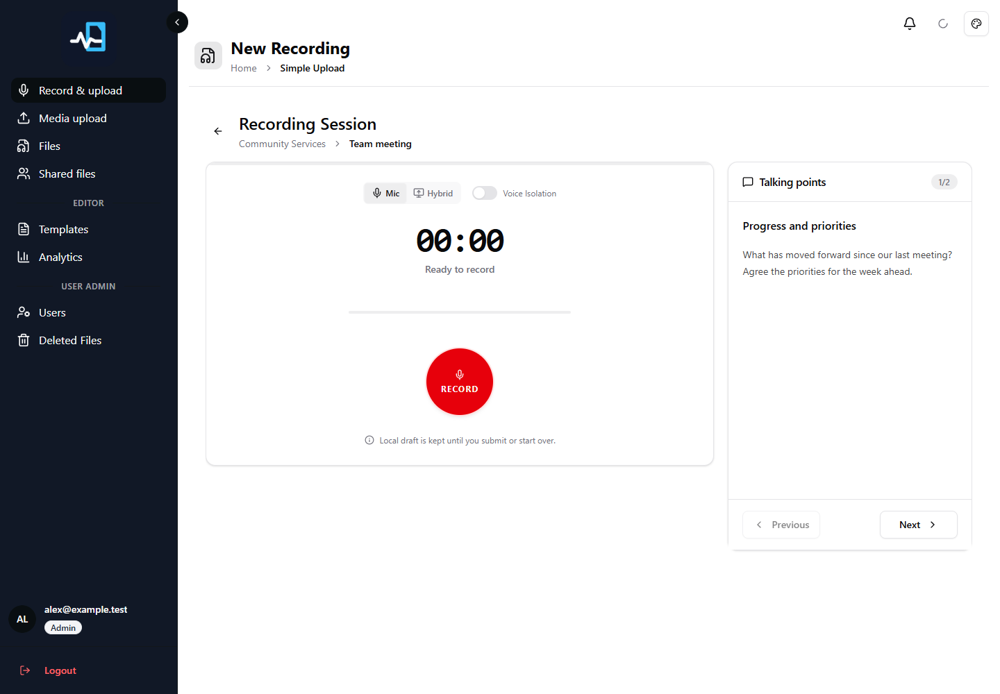
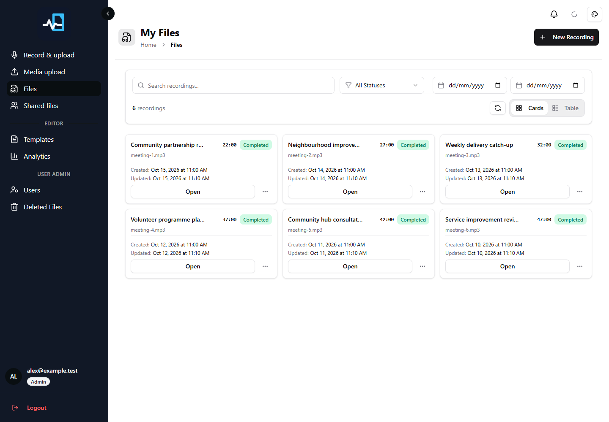
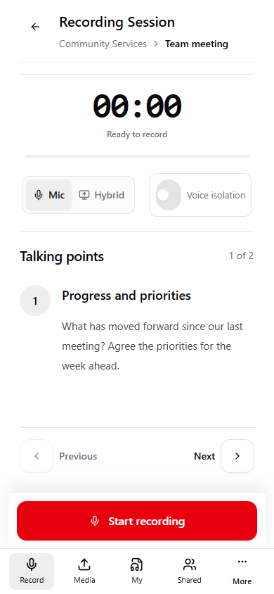
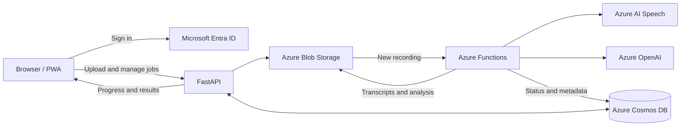

<p align="center">
  
</p>

<p align="center">
  Open-source recording, transcription, and meeting analysis. Built on Azure.
</p>

<p align="center">
  <a href="LICENSE"></a>
  
  
  
</p>

<p align="center">
  <a href="#product-tour">Product tour</a> ·
  <a href="#quick-start">Quick start</a> ·
  <a href="#how-it-works">Architecture</a> ·
  <a href="docs/deployment.md">Deployment</a> ·
  <a href="#documentation">Documentation</a> ·
  <a href="CONTRIBUTING.md">Contribute</a>
</p>

---

Community Brief brings recording, transcription, reusable templates, and AI analysis into one workspace. Capture meetings, organise files, and turn unstructured conversations into reports shaped around your team's workflows.

Use it as a foundation for team meetings, project reviews, interviews, and community consultations. You host the application and connect your own identity, storage, and AI services.

## Product tour



<p align="center"><sub>Real application screens, captured locally with fictional data. Features depend on permissions and configuration.</sub></p>

### Choose a template

Choose a service area and meeting type, or jump straight to a favourite. Templates bring a consistent structure to preparation, talking points, and analysis.



### Record a meeting

Record from the browser with session controls, microphone options, and template talking points. The responsive interface supports desktop and mobile use.



### Manage your files

Find recordings in one library, filter by date or status, and open completed jobs to review transcripts and analysis. Share files with colleagues through the application's access controls.



<details>
<summary><strong>View the mobile recording screen</strong></summary>
<br>
<p align="center"></p>
</details>

## What you can do

|     | Capability                  | What it provides                                                                                                                         |
| --- | --------------------------- | ---------------------------------------------------------------------------------------------------------------------------------------- |
| 🎙️  | **Record and upload**       | Browser recording and media/document upload workflows.                                                                                   |
| 📝  | **Transcribe and analyse**  | Asynchronous processing with Azure AI Speech and configured AI deployments.                                                              |
| 🧩  | **Reuse templates**         | Service areas, meeting types, talking points, and configurable analysis prompts.                                                         |
| 📱  | **Work on the move**        | Responsive screens and an installable progressive web app.                                                                               |
| 📴  | **Prepare for offline use** | Account-specific cached templates, local drafts, and queued uploads. Sign in and sync online first; cloud processing needs connectivity. |
| 🤝  | **Collaborate**             | File sharing, business-unit membership, and role-based access.                                                                           |
| 📊  | **Manage the workspace**    | Analytics, template management, and administration for permitted roles.                                                                  |
| 💬  | **Import from Teams**       | Optional transcript and recording import, subject to Graph permissions and tenant policy.                                                |

## Quick start

You need **Node.js 22**, **pnpm 11.5.2**, and **Python 3.11+**. Running the worker locally also requires **Azure Functions Core Tools v4**. Supply your own Azure resources and Microsoft Entra ID registration; this is a connected application.

```powershell
git clone https://github.com/mitchellrevil/community-brief.git
cd community-brief
```

**1. Start the API** in a terminal from the repository root:

```powershell
cd backend_app
python -m venv .venv
.\.venv\Scripts\Activate.ps1
python -m pip install -r requirements.txt
Copy-Item .env.example .env
# Configure .env with your identity, storage, database, and AI settings.
uvicorn app.main:app --reload --port 8000
```

**2. Start the frontend** in a second terminal from the repository root:

```powershell
cd frontend_app
pnpm install --frozen-lockfile
Copy-Item .env.example .env
# Configure .env with your API URL and Entra identity settings.
pnpm dev
```

Open [http://localhost:3000](http://localhost:3000). The API provides [interactive documentation](http://localhost:8000/docs) and a [readiness endpoint](http://localhost:8000/health/ready).

**3. Connect the processing worker.** Follow the [Functions quickstart](az-func-audio/QUICKSTART.md) to configure `local.settings.json` and run `func start`, or connect the API to your deployed worker. Transcription and analysis require the worker and its cloud dependencies.

See the **[complete setup guide](docs/getting-started.md)** for resource requirements, identity configuration, shared settings, and first-run verification. Commands above use PowerShell; the guide includes macOS/Linux virtual-environment activation.

## How it works



The API manages authentication, jobs, templates, and stored content. The worker processes uploads asynchronously, writes results, and updates status. The frontend presents progress and completed results.

| Component                          | Stack                                                           | Responsibility                                                  |
| ---------------------------------- | --------------------------------------------------------------- | --------------------------------------------------------------- |
| [`frontend_app/`](frontend_app/)   | React 19, TypeScript, Vite, TanStack Router/Query, Tailwind CSS | Recording, file library, templates, and administration.         |
| [`backend_app/`](backend_app/)     | Python, FastAPI                                                 | Authentication, APIs, job orchestration, and persistence.       |
| [`az-func-audio/`](az-func-audio/) | Python, Azure Functions                                         | Transcription, AI analysis, and reprocessing.                   |
| [`docs/`](docs/)                   | Markdown and documentation assets                               | Setup, hosting guidance, model configuration, and product tour. |

Read the [architecture guide](docs/architecture.md) for the processing lifecycle and service boundaries.

## Deployment

Host the React frontend, FastAPI API, and Azure Functions worker in your own environment. Azure Static Web Apps and App Service are possible hosts for the frontend and API; the processing worker uses Azure Functions.

This repository supplies application code and a validation/package pipeline. Provisioning infrastructure and deploying the packages are your responsibility. Follow the **[deployment guide](docs/deployment.md)** for the resource map, configuration boundaries, and rollout checks.

## Documentation

| I want to…                                 | Read                                                                                    |
| ------------------------------------------ | --------------------------------------------------------------------------------------- |
| Run locally                                | [Getting started](docs/getting-started.md)                                              |
| Understand processing                      | [Architecture](docs/architecture.md)                                                    |
| Plan a deployment                          | [Deployment guide](docs/deployment.md)                                                  |
| Configure AI models and template arguments | [Model catalogue](docs/model-catalog.md)                                                |
| Work on the frontend                       | [Frontend reference](frontend_app/README.md) · [Quickstart](frontend_app/QUICKSTART.md) |
| Work on the API                            | [Backend reference](backend_app/README.md) · [Quickstart](backend_app/QUICKSTART.md)    |
| Work on transcription and analysis         | [Worker reference](az-func-audio/README.md) · [Quickstart](az-func-audio/QUICKSTART.md) |
| Contribute or reproduce screenshots        | [Contributor guide](CONTRIBUTING.md)                                                    |
| Resolve a setup problem                    | [Troubleshooting and FAQ](docs/troubleshooting.md)                                      |

## Contributing and support

Bug reports, documentation improvements, and focused pull requests are welcome. Start with [CONTRIBUTING.md](CONTRIBUTING.md) for development checks and guidance on useful reports.

Use [GitHub issues](https://github.com/mitchellrevil/community-brief/issues) for bugs and feature requests. Include reproduction steps and sanitised diagnostics. Review AI-generated results before using or sharing them, and configure recording consent, retention, and access for your organisation's needs.

## Acknowledgements

Community Brief builds on the original [Azure-Samples transcription accelerator](https://github.com/Azure-Samples/sonic-brief). Thank you to its authors and contributors for the application foundation and architecture documentation.

## License

Released under the [MIT License](LICENSE). Azure and other connected services require your own accounts and may incur usage charges.
